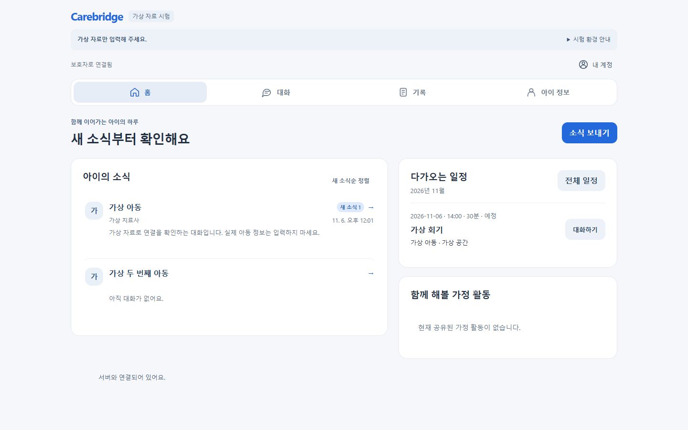

# Carebridge

아이를 중심으로 보호자·치료사·센터를 연결하는 아동 발달 플랫폼 프로젝트입니다. 홈에서 아이의 소식을 확인하고, 대화와 공유 기록을 읽고, 다음 활동·치료 기록으로 이어지는 흐름을 개발합니다.

## 현재 화면과 실행 방식

| 구분 | 경로 | 실행 | 범위 |
| --- | --- | --- | --- |
| 최신 UI·API 시험 앱 | `local-api/`, `server/` | `npm run dev:local-api` | 가상 계정으로 로그인하는 로컬 전용 시험 환경 |
| 기존 정적 프로토타입 | `src/` | `npm run dev` | 브라우저 내 가상 역할 전환 데모 |
| Vercel 정적 출력 | `dist/` | `npm run build` | 기존 정적 프로토타입만 포함 |

**최신 UI 소스를 GitHub에 올리는 것과 Vercel에 최신 API 앱을 운영 배포하는 것은 별개입니다.** 현재 Vercel 빌드는 `local-api/`와 서버를 포함하지 않습니다. 공개 데모에는 실제 아동 정보·사진·영상을 입력하지 마세요.

## 최신 UI

- 모바일: 한 열의 홈, 아이콘과 이름을 함께 표시하는 하단 메뉴, 화면 높이에 맞춘 대화·입력 영역.
- PC: 소식과 일정/활동을 나란히 배치한 홈, 대화 목록과 넓은 읽기 영역.
- 기록: 활동·아이 반응·다음 계획, 필요한 상세 관찰·복수 측정, 보호자 공유 전 미리보기.
- 계정: ‘내 계정’ 메뉴에 설정·새로고침·로그아웃을 배치하고 키보드 조작 지원.

[2026-11-06 PC Chrome 모바일 검수 및 업로드 범위](docs/github-release-20261106.md) · [UI 변경 상세](docs/responsive-ux-20261103.md)



[모바일 홈](docs/screenshots/20261106/mobile-home.png) · [모바일 대화](docs/screenshots/20261106/mobile-chat.png) · [모바일 기록](docs/screenshots/20261106/mobile-records.png)

## 로컬 실행

Node.js 24와 npm을 사용합니다. 최신 UI를 실행하려면 직접 사용하는 대화형 터미널에서 다음을 실행하세요.

```sh
npm ci --ignore-scripts
npm --prefix server ci --ignore-scripts
npm run dev:local-api
```

터미널에 표시된 로컬 주소와 매번 새로 생성되는 가상 계정으로 로그인합니다. 기본 주소는 `http://127.0.0.1:4180/`이며 다른 기기에 공개하지 않습니다. 종료는 `Ctrl+C`입니다. 메모리 시험 데이터는 종료 시 사라집니다. 기본 실행기의 첨부는 격리 업로드 시험이며 실제 파일 검사·상대방 전달은 별도 시험 실행기의 범위입니다. [상세 실행 안내](docs/local-api-connection.md).

기존 정적 데모는 루트 설치 후 `npm run dev`로 실행합니다.

## 검사

```sh
npm run check
npm test
npm run build
```

DB를 실제로 생성하는 fixture 검사는 정적 배포 검사와 분리되어 있습니다. 서버 개발 의존성을 설치한 뒤 실행하며, 의존성이 없으면 실패합니다. 비교 fixture는 저장소의 고정된 과거 Git 객체도 확인하므로 전체 Git 이력이 필요합니다.

```sh
npm run test:fixtures:local
```

최신 UI 브라우저 검사는 `PLAYWRIGHT_MODULE`에 설치된 Playwright의 `index.mjs`, `STUDY_CHROMIUM_EXECUTABLE`에 Chrome 실행 파일의 절대 경로를 지정한 후 실행합니다. 서버 개발 의존성 설치가 필요합니다.

```sh
npm run test:local-product:browser
npm run test:p0-local-api:browser
```

첫 명령은 가상 계정·메모리 DB로 화면 크기별 이동·대화·기록 및 권한 분리를 검사합니다. 결과는 공개 제외된 `test-results/`에 생성됩니다. 날짜별 문서의 과거 검사 수는 당시 결과이며 현재 운영 서비스의 검증을 의미하지 않습니다.

## 데이터와 배포 범위

이 저장소에는 소스·검사 코드·가상 fixture와 선별된 합성 화면만 포함합니다. 개인키·로그인 자격증명·실제 사용자 데이터·DB·업로드 파일·로컬 검사 전체 산출물은 포함하지 않습니다. 최신 API 앱의 실제 자료 운영, 외부 공개, 독립 백업·메일 공급자와 운영 배포는 별도 준비가 필요합니다.

2026-11-06 요청에 따라 이번 모바일 검수는 PC Chrome 안에서 수행했습니다. 실제 아이폰 시험이나 사람의 사용성 점수를 대신하는 결과로 표시하지 않습니다.

[구현 수용 현황](docs/communication-acceptance.md) · [서버 구조](docs/server-foundation.md) · [배포 안내](docs/deployment.md)
